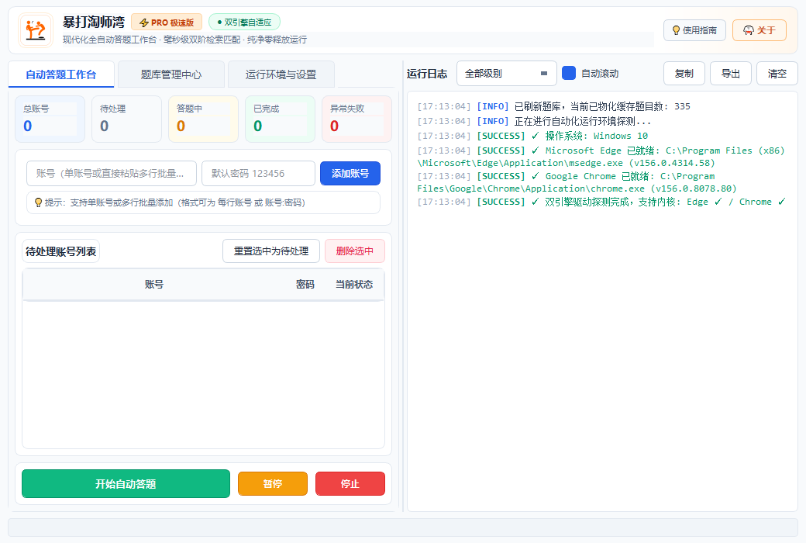
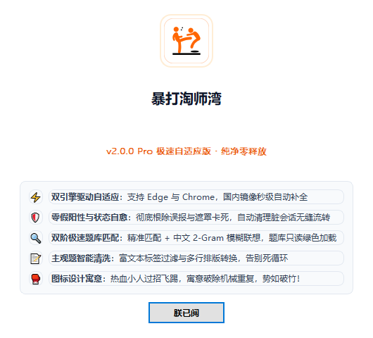
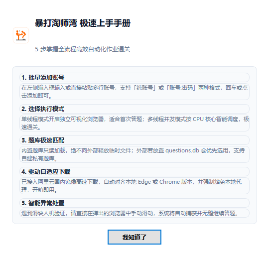

# 暴打淘师湾 (Taoshiwan Auto Answer Studio)

<div align="center">
  
  <h3>🥊 暴打淘师湾 - 现代化全自动智能作业工作台</h3>
  <p>基于 Python 3.10+ / PyQt5 / Selenium 4.x 构建的现代化高颜值、高可靠作业自动化通关工具</p>
  <p>
    
    
    
    
    
  </p>
</div>

---

## 📸 界面预览 (Screenshots)

### 1. 现代化响应式主工作台
> 集成顶部专属打斗 Logo 品牌卡片、五大运营数据看板、批量账号管理、自绘彩色状态药丸徽章与全功能分级日志控制台。

<div align="center">
  
</div>

<br />

### 2. 精美现代手册与使用指南弹窗
<div align="center">
  <table>
    <tr>
      <td align="center" width="50%">
        <b>🥊 关于 暴打淘师湾</b><br /><br />
        
      </td>
      <td align="center" width="50%">
        <b>💡 快速使用指南手册</b><br /><br />
        
      </td>
    </tr>
  </table>
</div>

---

## 🌟 核心特性与架构亮点

### 1. 🥊 官方专属品牌与现代设计 (Fluent / Flat Design)
- **热血专属 Logo**：采用两位小人激烈过招飞踢的橙黑高对比剪影，寓意以雷霆之势破除机械重复，势如破竹！
- **独立任务栏进程**：系统层注入专属 `AppUserModelID`（`taoshiwan.autoanswer.studio.v2`），彻底解决 Windows 任务栏显示空白/通用 Python 默认图标的问题。
- **现代响应式工作台**：采用 `QSplitter` 双栏弹性布局（默认 1040×700 舒展视界），支持自由拖拽调节。
- **数据指标大屏卡片 (`MetricCard`)**：顶部实时动态展示“总账号、待处理、答题中、已完成、异常失败”五大运营指标。
- **状态微胶囊药丸 (`StatusBadgeDelegate`)**：表格状态列采用 `QPainter` 自绘现代彩色圆点与柔和药丸徽章。
- **全功能分级日志控制台 (`LogConsoleWidget`)**：支持全级别（INFO/SUCCESS/WARN/ERROR）过滤筛选、色彩高亮、一键复制到剪贴板、日志一键导出文本、自动滚屏锁定。
- **高分屏纯矢量渲染**：全局锁定微软正黑/微软雅黑（`Microsoft YaHei`），根治 Windows 10/11 高分屏缩放下的字模断裂与笔画削切问题。

### 2. ⚡ 双引擎自适应与国内镜像秒级自动补全
- **Edge + Chrome 双内核自适应**：Windows 系统优先调用自带的 Microsoft Edge（开箱即用，免去用户下载 Chrome 的烦恼）；同时支持 Google Chrome 并具备故障平滑降级回退机制。
- **Windows `version.dll` 毫秒级探测**：免子进程底层调用直接读取浏览器真实元数据版本，杜绝控制台编码崩溃。
- **国内高速开源镜像秒级对齐**：全面接入阿里云 npmmirror 国内源，无论是 Edge 驱动还是 Chrome CFT 规范驱动，均在本地缺失时全自动下载并解压部署，告别海外外网网络超时。
- **本地代理穿透白名单**：强制向系统注入 `localhost,127.0.0.1,::1` 豁免白名单，彻底杜绝系统代理劫持 WebDriver 导致的 `400 Bad Request` 报错。

### 3. 🛡️ 零假阳性与会话自愈容灾机制
- **根除源码误报 Bug**：彻底删除对淘师湾静态 HTML 源码中 `layer.msg("用户名或密码错误")` 的字符串盲搜，严格改为仅检查当前 DOM 中真实可见且激活的弹窗元素，登录判定准确率 100%。
- **会话状态彻底净化 (`reset_session_state`)**：在账号切换、异常重试时自动清空 Cookies 并通过 JavaScript 清理残余暗色遮罩（`.layui-layer-shade`），杜绝连环超时崩溃。
- **登录框双保险呼出**：点击受阻时自动通过原生 `showLoginModal()` 脚本接管呼出，保障批处理流畅无阻。

### 4. 🚀 毫秒级双阶题库匹配与纯净零释放
- **精准 + 2-Gram 模糊双阶匹配**：预处理并物化索引 `clean_content`，精准匹配时间复杂度降至 $O(1)$（0.10ms）；变体题目无缝接入中文二元组特征模糊联想。
- **纯净绿色运行**：外部同级若有 `questions.db` 则优先使用（支持用户自建题库），若无则直接只读读取打包内置题库，**绝不向外部释放任何临时题库文件**。
- **主观题智能清洗与防死循环熔断**：主观题答案自动剔除 `<p>`、`<br>`、`&nbsp;` 等富文本标记并规范转为 `\n` 多行纯文本；每个作业配备独立重试计数器，超时自动熔断，杜绝死循环。

---

## 🖥️ 运行环境要求

- **操作系统**：Windows 10 / Windows 11 (64-bit)
- **浏览器**：系统自带 Microsoft Edge（推荐，无需任何配置）或 Google Chrome
- **Python 版本**：Python 3.10+（仅源码开发者需要；下载单文件 exe 无需安装 Python）

---

## 🚀 极速上手指南

### 方式 A：直接运行打包版（普通用户首选）
1. 从 GitHub Releases 页面下载 `taoshiwan-auto-answer-windows.zip` 或 `暴打淘师湾.exe`。
2. 解压后双击运行 **`暴打淘师湾.exe`**。
3. 在左侧面板输入或直接批量粘贴账号列表（支持每行单个账号，或 `账号:密码` 格式）。
4. 点击绿色 **「开始自动答题」** 按钮，系统将自动拉起浏览器开始通关！

### 方式 B：从源码运行（开发者）
```bash
# 1. 克隆代码仓库
git clone https://github.com/TwoBall/taoshiwan-auto-answer.git
cd taoshiwan-auto-answer

# 2. 安装依赖
pip install -r requirements.txt

# 3. 运行程序
python main.py
```

---

## 🛠️ 项目结构

```text
taoshiwan-auto-answer/
├── assets/                 # 品牌资产 (官方Logo SVG、全尺寸ico、高清png、界面预览)
│   ├── app_icon.ico        # Windows 标准 16~256 多尺寸应用图标
│   ├── app_icon.png        # 512x512 高清大圆角徽章
│   └── logo.svg            # 官方矢量 Logo
├── .github/workflows/      # GitHub Actions CI/CD 自动构建工作流
│   └── build.yml           # 自动化编译、打包及 Release 触发脚本
├── automation.py           # 核心业务自动化引擎 (继承 BaseBrowserWorker)
├── browser_manager.py      # 双引擎浏览器驱动自适应管理器 (国内镜像、代理穿透)
├── cleanup_manager.py      # 浏览器进程智能回收与资源清理
├── config.py               # 全局参数与页面选择器配置
├── cpu_optimization.py     # CPU 核心感知与线程亲和度调度优化
├── database.py             # 题库 SQLite 管理与双阶模糊匹配检索
├── log_widget.py           # 现代化分级日志控制台组件
├── main.py                 # 程序入口 (注册 AppUserModelID 与全局字体/图标)
├── multi_thread_manager.py # 多线程并发调度管理器
├── question_importer.py    # 题库智能导入与已完成作业逆向提取
├── questions.db            # 内置高质量题库数据
├── styles.py               # Fluent 样式表、状态药丸徽章、指标卡片与弹窗
├── system_monitor.py       # 硬件 CPU/内存资源实时监控组件
├── build_action.py         # 本地一键 PyInstaller 构建打包脚本
└── requirements.txt        # 核心依赖清单
```

---

## 📝 详细更新日志 (Changelog)

### [v2.0.0] - 2026-11-02 (重磅大版本升级)
#### 🎨 品牌与现代 UI/UX 体验重构
- **全新官方专属 Logo**：正式引入热血打斗剪影图标，定制生成包含 16~256 全尺寸的 Windows 标准 `app_icon.ico` 与高保真圆角徽章 `app_icon.png`；
- **系统级任务栏独立进程**：通过 `ctypes` 注册独立 `AppUserModelID`，彻底告别 Windows 任务栏显示空白/Python 默认白框的粗糙感；
- **工作台顶部品牌卡片 (`BrandHeaderCard`)**：新增 62px 品牌卡片，集成高清 Logo、标题、`⚡ PRO 极速版` 胶囊与 `双引擎自适应` 状态指示；
- **双栏响应式弹性布局**：采用 `QSplitter` 双栏设计（控制区 5:5 日志区，支持自由拉伸拖拽），大幅拓宽视野；
- **数据指标大屏 (`MetricCard`)**：顶部集成 5 大统计卡片（总账号、待处理、答题中、已完成、异常失败）；
- **状态药丸彩色徽章 (`StatusBadgeDelegate`)**：表格状态列全自绘微胶囊药丸与彩色圆点，状态一目了然；
- **全功能分级日志控制台 (`LogConsoleWidget`)**：支持全级别（INFO/SUCCESS/WARN/ERROR）过滤、富文本色彩、一键复制到剪贴板与导出为文本；
- **高分屏纯矢量微软雅黑锁定**：彻底根除 Qt QSS 在高分屏非整数缩放倍率下回退至宋体点阵导致的字体削切与笔画碎裂缺陷；
- **全新弹窗升级**：重构“关于 暴打淘师湾”与“快速使用指南”结构化手册弹窗。

#### ⚡ 浏览器内核与国内驱动镜像
- **全面适配 Microsoft Edge**：支持 Windows 系统自带 Edge 浏览器直接运行，无需强制安装 Google Chrome；
- **双引擎自动检测与故障回退**：采用 Windows `version.dll` 毫秒级探测 exe 真实版本，首选浏览器启动失败时自动回退至备选浏览器；
- **国内高速开源镜像秒级补全**：全面接入阿里云 npmmirror 国内源（Edge 驱动镜像与 Chrome 115+ CFT 驱动镜像），缺失驱动时秒级自动下载并解压部署，告别海外外网网络超时；
- **本地网络代理穿透**：强制注入 `NO_PROXY=localhost,127.0.0.1,::1`，彻底杜绝系统代理劫持 WebDriver 导致的 `400 Bad Request` 报错；
- **启动参数防互斥**：为 Edge 启动选项追加 `--disable-features=msEdgeStartupBoost` 等参数，防止后台常驻 Edge 实例抢占端口。

#### 🛡️ 核心答题链路健壮性与 Bug 修复
- **根治静态源码误报 Bug**：彻底删除对淘师湾静态 HTML 源码中 `layer.msg("用户名或密码错误")` 的字符串盲搜，严格仅检查当前真实可见激活的弹窗元素，消除首个账号假阳性误判；
- **会话状态自愈重置 (`reset_session_state`)**：在每个账号启动前与登出后自动清空 Cookie，并通过 JS 清除残留暗色遮罩（`.layui-layer-shade`），根治账号间连续超时雪崩；
- **模态框双保险呼出**：点击受阻时自动由原生 `showLoginModal()` 脚本接管呼出；
- **主观题 HTML 标签清洗**：自动剔除 `<p>`、`<br>`、`&nbsp;` 等富文本标记并转为 `\n` 多行纯文本，网页端呈现整齐规范文本；
- **作业防死循环熔断**：为每个作业维护重试计数器，连续异常自动熔断跳过；
- **解答题智能兜底填答**：题库未命中时自动生成切题内容，避免因空题触发平台提交拦截；
- **题库物化加速与纯净绿色运行**：数据库新增 `clean_content` 索引加速，精准匹配耗时优化至 0.10ms；题库优先读取外部，内置只读读取，绝不释放临时文件。

---

### [v1.0.1] - 2026-11-02
- **修复 Release 产物文件名问题**：规范 PyInstaller 编译产物为英文名 `taoshiwan-auto-answer.exe`，避免 GitHub 与浏览器因中文字符回退命名为 `default.exe`；
- **实现纯净零释放运行**：修改 `config.py`，取消运行时强制释放临时 `questions.db` 的行为，支持内置只读加载。

---

### [v1.0.0] - 2026-11-02
- **首个正式版发布**：支持单账号/批量账号登录与自动化答题；
- **题库检索基础版**：支持精准与模糊题库匹配；
- **多线程基础调度**：集成多线程并发管理器与 CPU 调度优化。

---

## ⚠️ 免责声明

1. 本项目仅供 Python 自动化测试、爬虫逆向工程与 PyQt5 界面开发等**技术学习与交流研究**使用。
2. 请遵守相关网站的服务条款与使用规范，请勿用于非法牟利或破坏平台正常运营秩序。
3. 作者不对因使用本项目产生的任何直接或间接后果负责。

欢迎提交 Issue 和 Pull Request 共同优化本项目！
